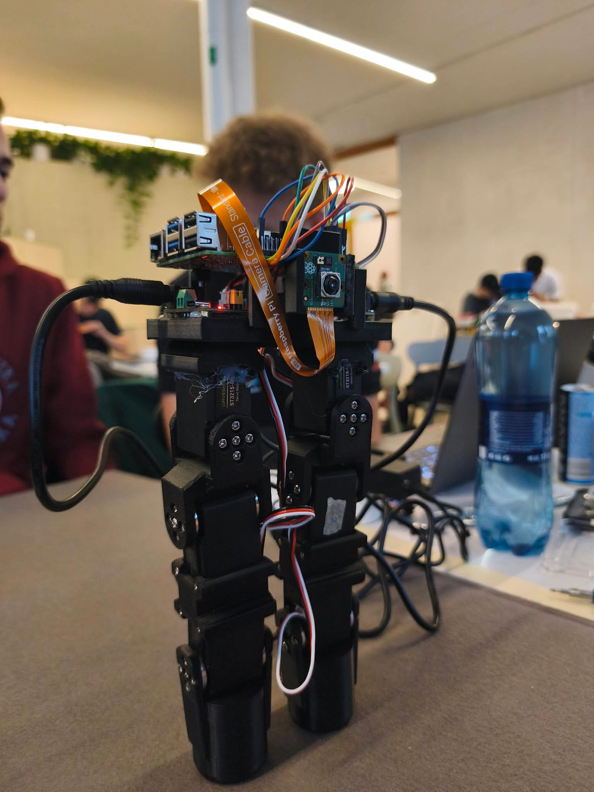
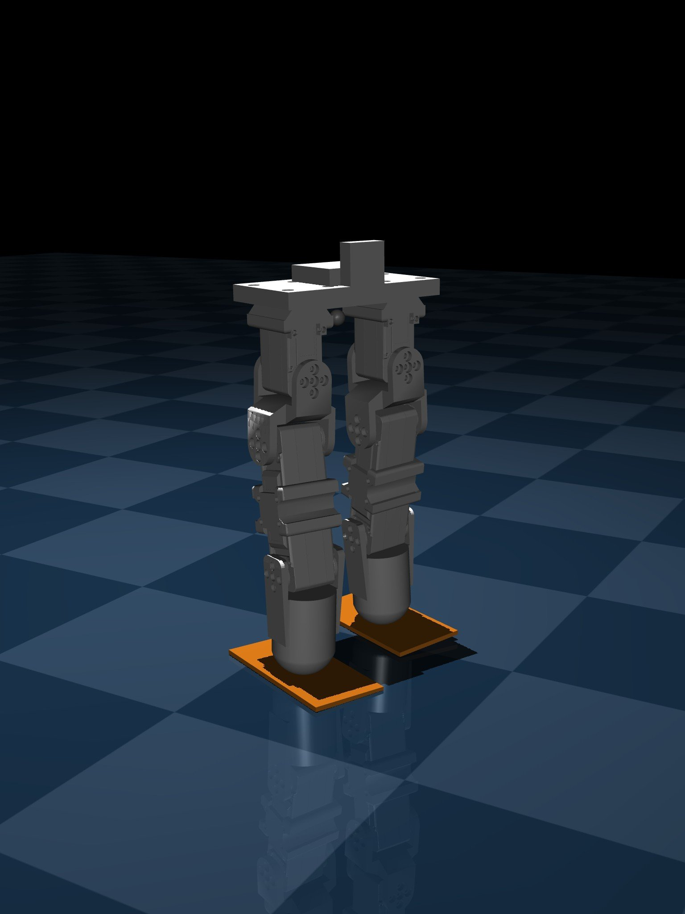
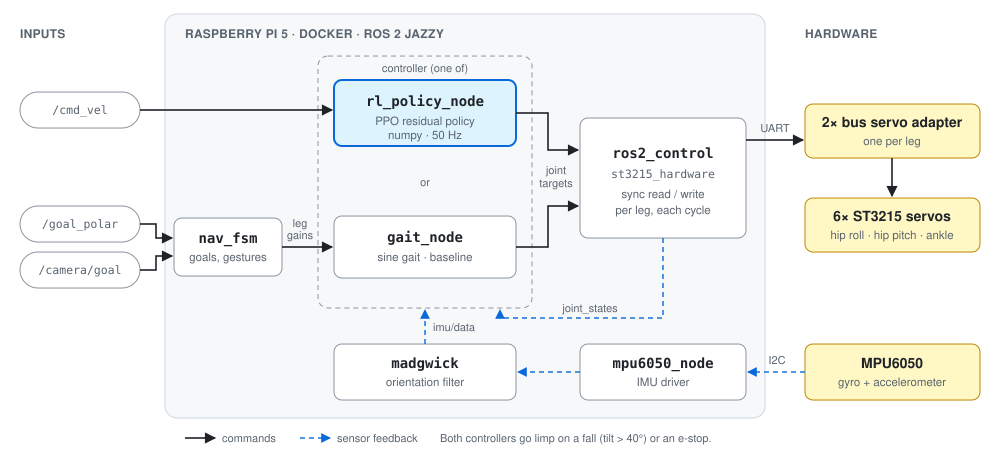

# Biped — sim-to-real RL walking on a 6-DOF robot

A small two-legged robot built at the **Zurich Physical AI Hackathon**. It walks with a PPO policy trained in
MuJoCo and deployed on the real robot: six ST3215 serial bus servos, a Raspberry Pi 5, an MPU6050 IMU and ROS 2 Jazzy.

<table>
  <tr>
    <td align="center"><br><sub>The real robot</sub></td>
    <td align="center"><br><sub>The same robot in MuJoCo</sub></td>
  </tr>
</table>

## Main idea

```
joint targets = sine_gait(φ, command) + 0.15 rad × policy(observation)        at 50 Hz
```

- **Residual policy.** The network doesn't learn to walk from scratch. It corrects a simple sine gait by at most
  ±0.15 rad per joint, so it can fix the gait but can't drift into something that only works in simulation.
- **Only real sensors as input:** IMU gravity and gyro, joint positions and velocities, the last action, the gait
  clock, and the speed and turn commands. That's 28 numbers into an MLP with two hidden layers of 128.
- **Sim-to-real.** The real servos' latency (~80 ms), deadband and lag were measured and modelled in MuJoCo.
  Every training episode randomizes servo gains, delays, masses, friction, calibration offsets and sensor noise,
  and the robot gets pushed every few seconds.
- **Runs on the Pi in numpy.** The weights are exported to an `.npz` file, and inference is two matrix multiplications.

### Control flow on the robot



- `rl_policy_node` reads `joint_states`, `imu/data` and `/cmd_vel` and publishes joint targets at 50 Hz.
- `gait_node` is the plain sine-gait baseline on the same topics. `nav_fsm` (polar goals, camera gestures)
  drives it.
- `st3215_hardware` is the `ros2_control` driver: one sync read and one sync write per cycle on each leg's bus.
- Both controllers go limp on a fall (tilt > 40°) or an e-stop: the servo targets follow the measured pose.

## Layout

```
rl/                       MuJoCo env, PPO training, evaluation
ws/src/biped_control/     RL policy node, sine-gait baseline, IMU driver, servo tool, launch files
ws/src/st3215_hardware/   ros2_control driver for the ST3215 servos (C++)
ws/src/biped_description/ URDF, meshes, joint → servo mapping
ws/src/biped_sim/         MuJoCo simulation with the same ROS topics as the robot
scripts/                  deploy to the Pi, drive the robot from a laptop
```

## Run it

**Simulation, no ROS needed:** the shipped policy in the MuJoCo viewer:

```bash
python3 -m venv .venv-rl && .venv-rl/bin/pip install mujoco gymnasium numpy
.venv-rl/bin/python rl/eval.py ws/src/biped_control/policies/plates_v1.npz --viewer
```

**Simulation with the full ROS stack** (ROS 2 Jazzy + `pip install mujoco`):

```bash
cd ws && colcon build --symlink-install && cd ..
scripts/sim.sh policy:=$PWD/ws/src/biped_control/policies/plates_v1.npz sole_size:="[0.10, 0.05, 0.003]"
ros2 param set /rl_policy enabled true
```

**Train** a policy:

```bash
python3 -m venv .venv-rl && .venv-rl/bin/pip install -r rl/requirements.txt
.venv-rl/bin/python rl/train.py --name my_run      # → rl/runs/my_run/policy.npz
```

**Real robot** (everything runs in Docker on the Pi):

```bash
scripts/deploy.sh pi@<robot-ip>     # copy the repo to the Pi, build and start the container
scripts/robot.sh start-rl           # stand up with the policy loaded
scripts/robot.sh rl-on              # walk
scripts/robot.sh teleop             # steer from the keyboard
scripts/robot.sh estop
```

Run `scripts/robot.sh` with no arguments to list all commands, including the sine-gait baseline and calibration.
